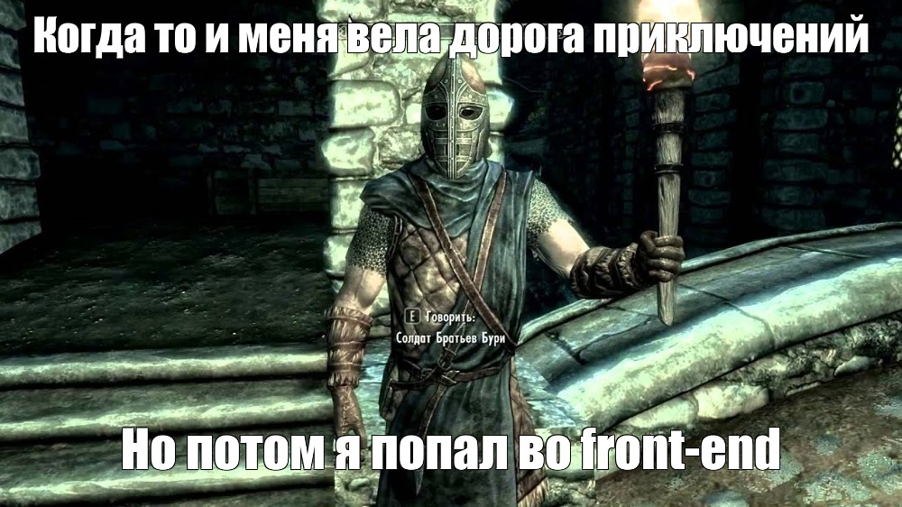

## О Себе

  

- 🧭 **Lead Fullstack-разработчик** (Node.js / TypeScript / Vue.js), 4+ года коммерческой разработки
- 🏢 Сейчас — Fullstack-разработчик / Feature Lead в **WONE IT**: микросервисная система автоматизации ЖКХ (200+ внутренних и 200 000+ внешних пользователей)
- 🛠️ Веду модули в полном цикле — от архитектуры и общения с заказчиком до деплоя; делаю code review, распределяю задачи и менторю разработчиков
- 🎓 Закончил УлГТУ; магистр в области ИИ и предиктивной аналитики
- 🤖 Активно использую AI-инструменты (Claude Code, Cursor) для разработки, рефакторинга и тестов
- 📍 Москва

  

## Опыт

| Период | Компания | Роль | Основной стек |
| --- | --- | --- | --- |
| 03.2025 — н. в. | WONE IT | Fullstack-разработчик / Feature Lead | TypeScript, Node.js, Moleculer, Dgraph, Redis, Vue.js |
| 03.2023 — 02.2025 | [Шевиант](https://sheviant.team/) | Ведущий Web-разработчик / Team Lead | Node.js, NestJS, Express, Vue.js, Nuxt, PostgreSQL, MySQL, MongoDB |
| 02.2022 — 03.2023 | Экоинформ | Fullstack-программист | C#, .NET, MS SQL, Nuxt |

## Проекты

- 🪪 **[Цифровая визитка](https://timovey.bir.ru)** — GraphQL API с профилем, опытом и проектами; на сайте открывается GraphiQL, можно сделать запрос самому. NestJS, Apollo GraphQL, Prisma, PostgreSQL, S3, Docker, Caddy · [код](https://github.com/Timovey/digital-business-card)
- 🧩 **Dophamint** — платформа квестов с конструктором развилок и прохождением в реальном времени. Модульный монолит на .NET 10, SignalR, Keycloak, OpenAPI-контракт с генерацией TS- и Dart-клиентов (код закрыт; предыдущая версия на микросервисах — [Quests](https://github.com/Timovey/Quests))
- 🛍️ **Шелковица** — интернет-магазин для заказчика: NestJS + TypeORM + PostgreSQL, витрина на Nuxt 3 (SSR/ISR), CI на каждый PR и деплой на свой сервер (код закрыт)
- ♻️ **[Green City](https://github.com/Timovey/green-city)** — система контроля вывоза ТБО: микросервисы на ASP.NET, EF Core, MS SQL, Hangfire, клиент на Nuxt + Vuetify

## Стек технологий

  

А ещё: Moleculer, Dgraph, Socket.IO, SignalR, Keycloak, Hangfire, Entity Framework Core, Pinia, S3, Bruno, OpenAPI.

## Статистика

## Контакты

